# Aether-Vision Engine

[](https://github.com/saniabduljabbar619-create/aether-engine/actions/workflows/tests.yml)

Async, event-driven multimodal AI system: face recognition (vectorized embedding
matching + temporal stabilization) and local speech (VAD + faster-whisper),
coordinated by an asyncio event bus, with a PySide6 desktop UI.

## Layout

| Path | Responsibility |
|------|----------------|
| `config/` | Pydantic settings (env-driven) |
| `core/` | Event bus, logging |
| `vision/` | Capture worker, detector/embedder, spatial engine (matcher + filter) |
| `audio/` | Mic recorder + VAD, Whisper STT |
| `storage/` | SQLite audit log, reference face assets |
| `ui/` | PySide6 window and asyncio-to-Qt bridges |
| `tests/` | Unit and concurrency tests |

## Setup

```bash
python -m venv .venv && source .venv/bin/activate
pip install -e ".[dev]"
cp .env.example .env
pytest
```

## Install

Python 3.10+. Use a virtual environment.

| Stage | Command | Packages |
|-------|---------|----------|
| Now (bus, config, spatial engine) | `pip install numpy pydantic pydantic-settings` | math, settings |
| Dev / tests | `pip install pytest pytest-asyncio ruff` | test runner, async tests, linter |
| Vision (next) | `pip install opencv-python mediapipe deepface` | camera, face detection, embeddings |
| Audio | `pip install faster-whisper sounddevice webrtcvad-wheels` | local STT, mic capture, VAD |
| UI | `pip install PySide6` | desktop GUI |

Or install by group: `pip install -e ".[dev]"`, `".[vision]"`, `".[audio]"`, `".[ui]"`.
(`sounddevice` also needs the system PortAudio library, e.g. `apt install libportaudio2`.)

## Event bus

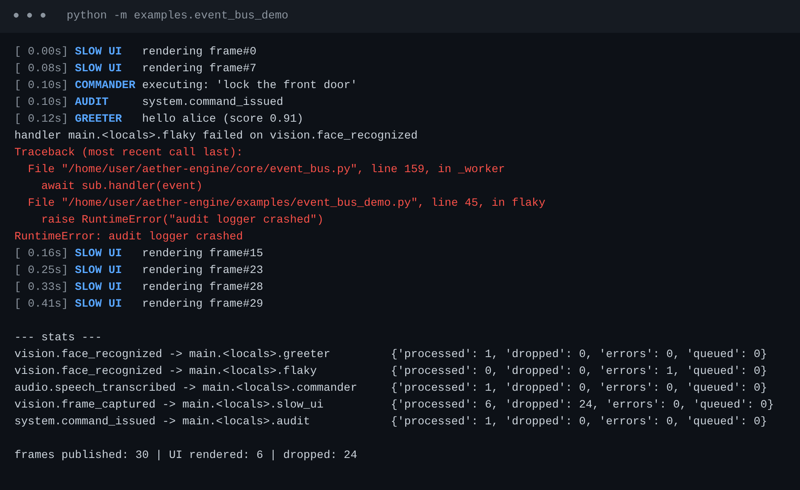

Run it: `python -m examples.event_bus_demo`. Tests: `pytest`.

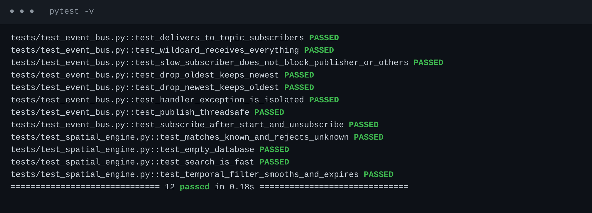

## Camera capture

`pip install opencv-python`, then `python -m examples.webcam_demo` (press `q` to quit).
No camera? `python -m examples.webcam_demo --synthetic`.

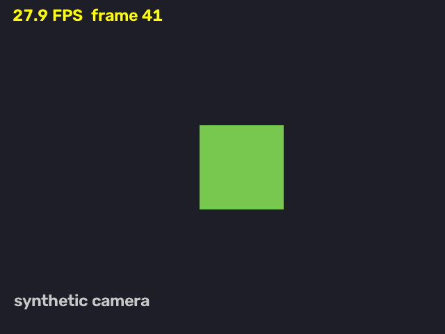
*Synthetic test pattern, not a real webcam.*

## Face detection

`python -m examples.detect_demo` (first run downloads two models, ~39 MB, into `models/`).
Only `opencv-python` is needed: YuNet detects faces, SFace produces 128-D embeddings.
Analyze a single image: `python -m examples.detect_demo --image photo.jpg --save out.png`.

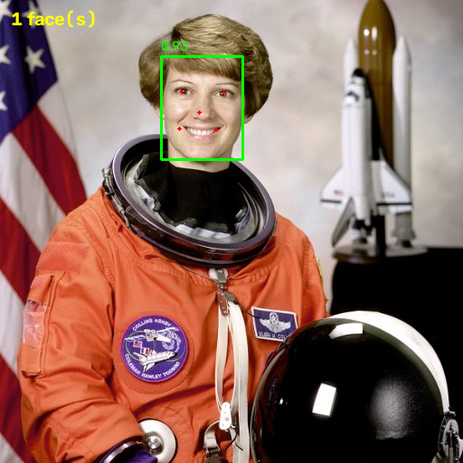
*NASA public-domain photo (scikit-image sample data).*

Note: SFace's recommended cosine threshold is **0.363**, which is now the default.

## Face recognition

```bash
python -m examples.enroll <your-name>      # webcam, 10 samples; or --image a.jpg b.jpg
python -m examples.enroll --list           # who is enrolled
python -m examples.recognize_demo          # live recognition, q to quit
```

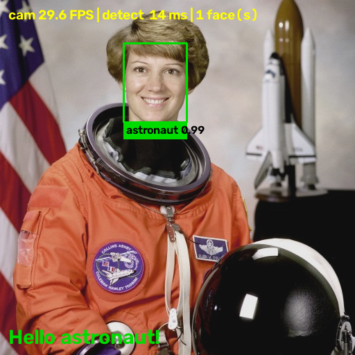
*Simulated camera showing a public-domain photo, enrolled as "astronaut".*

How it works: each face embedding is matched against all enrolled embeddings with one matrix
multiply (`vision/spatial_engine.py`). `vision/tracker.py` follows faces between frames by box
overlap (IoU), smooths boxes, and only commits to a name after a majority of recent frames agree,
so a single bad frame can't flip an identity. `FACE_RECOGNIZED` fires once per person, with a
30 s cooldown against repeat greetings.

Privacy: embeddings are stored locally in `storage/reference_faces/` and git-ignored.

## Voice

```bash
pip install faster-whisper sounddevice
python -m examples.voice_demo --list-devices
python -m examples.voice_demo            # speak; Ctrl+C to quit
python -m examples.voice_demo --wav clip.wav
```

`audio/recorder.py` cuts the mic stream into phrases (adaptive-noise-floor VAD, pre-roll so first
syllables aren't clipped, 700 ms hangover so pauses don't split a phrase). `audio/stt_engine.py`
transcribes each phrase locally with faster-whisper (default model `base`, int8 on CPU).

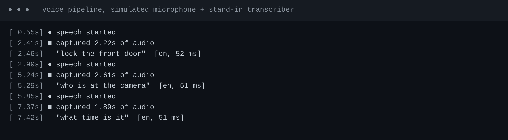
*Simulated microphone and a stand-in transcriber: shows the plumbing and timing, not Whisper accuracy.*

## Desktop window

`python main.py --gui` (needs `pip install PySide6`). Live camera with boxes and names, system status
and mic level, enrolled people (enroll with a button, forget with a button), a conversation log, an
activity tab fed by the audit log, and a box for typing commands when you would rather not talk.

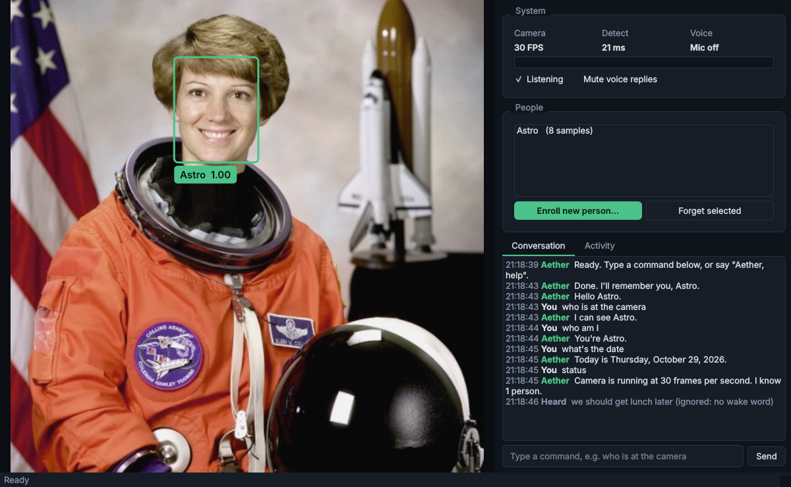
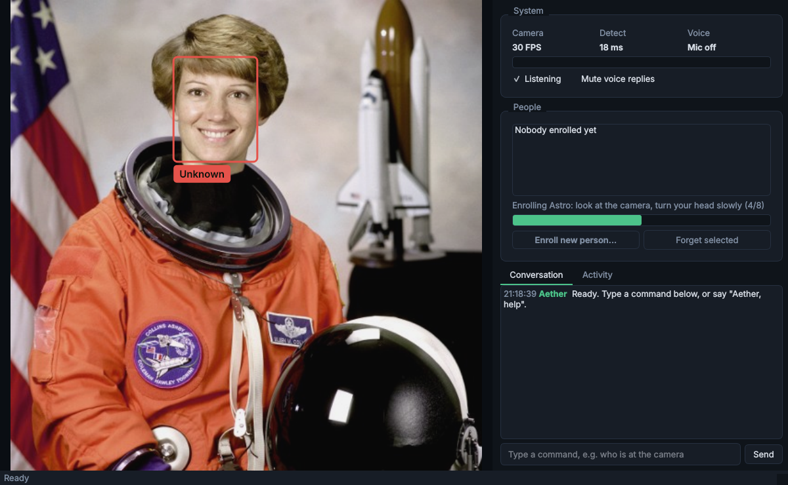
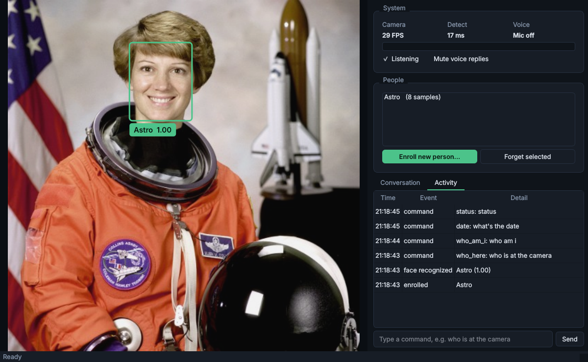
*Simulated camera (public-domain photo) with the real face models; real Qt window rendered offscreen.*

Design notes: the asyncio engine runs on its own thread and the window only talks to an
`EngineController` (`ui/qt_bridges.py`). Video frames pass through a latest-frame mailbox, so a slow UI
skips frames instead of lagging. Enrolling from the window is allowed without a recognized person in
view, because whoever sits at the keyboard is the administrator; the voice rules still apply to voice.

## The wake word

Speech models struggle with rare words, so Aether does not depend on hearing its name every time:

- **Follow-up window.** After Aether speaks (a greeting or an answer) the next 10 seconds accept
  harmless commands without the wake word, like talking to a person. The window shows "Follow-up (9s)".
  Talk that does not map to a command is ignored silently.
- **Push to talk.** The **Talk (F9)** button: the next thing you say is a command, no wake word needed.
- **Safety.** Without the wake word only read-only commands work (time, date, status, help, who is in
  view, who am I). Shutdown, forget, enroll, "who do you know", "recent activity" and your own commands
  still need it, so a "goodbye" said to someone else cannot shut the system down. Custom commands
  default to needing the wake word (`safe_without_wake=True` to opt out for read-only ones).
- **Choose a word the recognizer hears well:** `AETHER_WAKE_WORDS=computer` (several allowed, e.g.
  `aether,computer`; multi-word like `hey jarvis` works). The speech hint follows the wake word.
- **Measure instead of guessing:** `python -m examples.wake_test` has you say the phrase 10 times and
  reports how often the wake word and the whole command were understood; try `--model small` or
  `--wake computer` to compare.

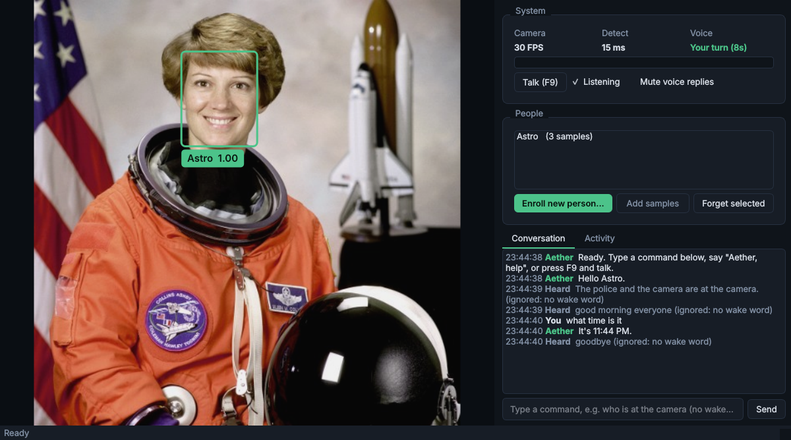
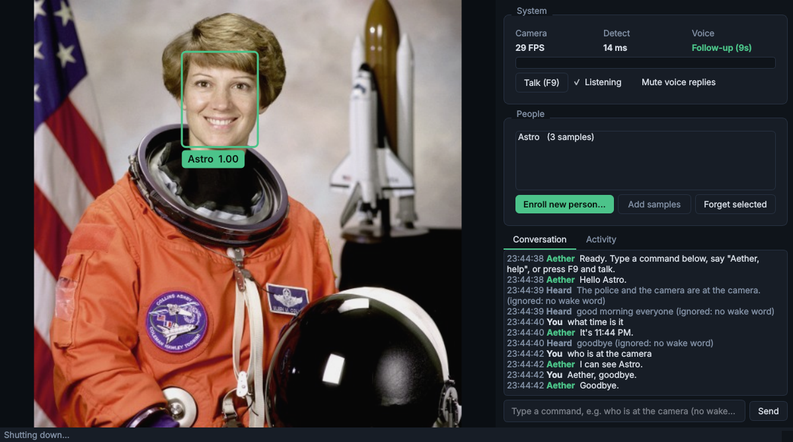
*Real face models with scripted speech-to-text results reproducing a real log: the garbled "The police and
the camera are at the camera." and chatter are ignored, a follow-up works without the wake word, a bare
"goodbye" does not shut down, push-to-talk works, and "Aether, goodbye" does.*

## Development and tests

```bash
pip install -e ".[dev,ci]"   # test tools + headless OpenCV and PySide6 (no Whisper or audio needed)
python -m pytest             # about 180 tests, ~15 s
ruff check .                 # lint: syntax errors, undefined names, unused imports
```

GitHub Actions (`.github/workflows/tests.yml`) runs lint and the tests on every pull request and push
to `main`: Python 3.10 (the declared minimum), 3.12 and 3.13 on Linux, plus Windows as a non-blocking
extra. The tests need no camera, microphone or Whisper model; the two small face models are downloaded
and cached. In CI the flag `AETHER_REQUIRE_ALL=1` turns "optional piece missing" from a quiet skip into a
failure, so a green check always means the whole suite ran (`tests/_optional.py`).

To make the check mandatory: GitHub, Settings, Branches, add a rule for `main`, tick "Require status
checks to pass" and select the `lint` and `tests (...)` checks.

## Enrollment quality

Enrollment keeps a few **different, clear** views of one person, not ten copies of one frame
(`vision/enrollment.py`). While you enroll it coaches you ("Look straight at the camera", "Slowly turn
your head a little to your right"), by voice and in the window. It

- accepts a sample only when exactly one clear, large-enough face is in view,
- asks for straight-on and slightly turned views, and waives the turns after 18 s for anyone who cannot,
- skips near-identical frames so every sample adds a new view,
- stops early if the face already matches someone else enrolled ("That face already matches X"),
- and at the end checks the samples agree with each other, so two people taking turns are rejected.

At startup (and in the People box) it warns when two names look like the same person, which makes
recognition flip between them. **Add samples** adds more views to an existing person.

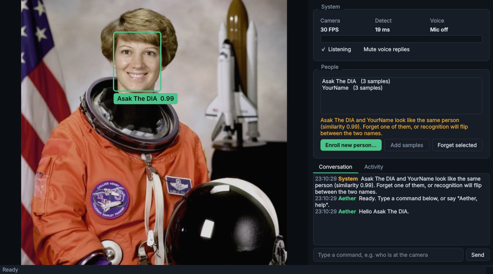
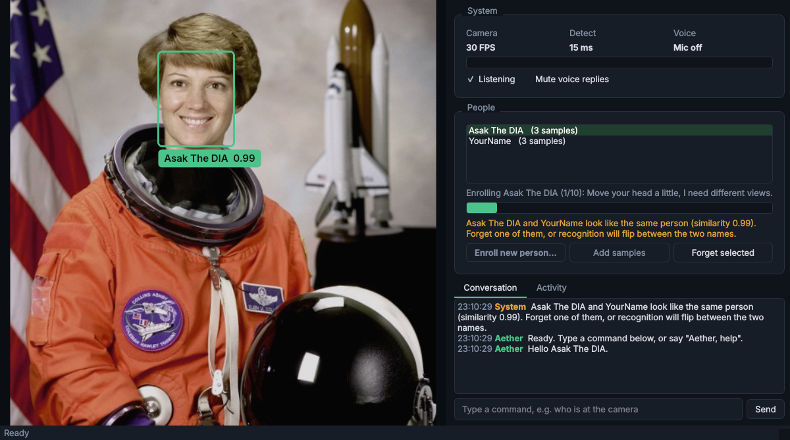
*Real face models on a simulated static camera: the warning for one face enrolled under two names, and
the coaching hint when nothing in the picture moves.*

Design note: darkness only produces a warning, never a rejection. An absolute brightness cut-off would
penalize darker skin tones and dim rooms. Quality comes from signals that do not depend on skin tone:
detector confidence, face size, pose variety, duplicate rejection and sample consistency. The head-turn
estimate averages the nose position against the eye line and the mouth line, which halved its noise in
measurements. The thresholds (turn 0.12, duplicate 0.96, consistency 0.45) are checked with synthetic
data and one real photo, not yet with many real people.

## Chat model and friendlier voice

**Chat (optional, local).** Anything the built-in commands do not cover ("Aether, why is the sky blue?") can go to a
small language model running on your own computer through [Ollama](https://ollama.com). It is off by default.

    ollama pull llama3.2:3b
    python -m examples.llm_check            # no camera or mic needed
    # then in .env:  AETHER_LLM_ENABLED=true

It is **read-only**: its words are only spoken or shown, never run, so it cannot enroll, forget or unlock anything;
those stay with the rule-based commands and their safety rules. The prompt names who is in view, so the server must
be on this computer (`AETHER_LLM_ALLOW_REMOTE=true` overrides). If Ollama is not running you hear one polite line and
the built-in commands keep working. A 3B model on a T440-class CPU takes several seconds per answer; try `llama3.2:1b`
if that is too slow.

**Friendlier activation.**
- The wake word works at the end too: "what time is it, Aether?"
- After an answer from the chat model you can keep talking without the wake word until a pause (about 10 s) or
  "thanks" / "that's all". Without a conversation going, chatter is still ignored.
- A bare "Aether" now answers "I'm listening." and opens a listening window.

## Liveness check ("verify me")

Face recognition alone can be fooled by a photo. "Verify me" asks you to turn your head to a **randomly chosen**
side and checks *how the face moves*: a real nose sticks out about 3 cm, so turning slides it across the eyes
and mouth; a flat photo (even one held at an angle or turned on a phone) moves rigidly and the nose barely shifts.

    python -m examples.liveness_demo --selftest   # no camera: simulated head vs simulated photo
    python -m examples.liveness_demo              # live, on your webcam

Say "Aether, verify me" or click **Verify me**. Only one recognized person may be in view, and the face that turns
must stay the same person throughout. A pass lasts `AETHER_VERIFIED_SECONDS` (60 s).

By default it is informational. Set `AETHER_REQUIRE_LIVENESS=true` and enrolling an extra person, forgetting
someone, and any custom command registered with `requires_verified=True` (say, unlocking a door) need a recent pass.

What it does **not** stop: a *video* of the person turning the requested way, a 3D mask, or someone physically
present who is already recognized. It raises the bar from "any photo" to "a deliberate attack"; it is not a
bank-grade check. Please test it on your own camera with a real turn and a phone photo and share the numbers.

## Tuning for your machine

Settings come from environment variables or a `.env` file in the project folder (see `.env.example`).

| Setting | Default | What it does |
|---------|---------|--------------|
| `AETHER_WHISPER_LANGUAGE` | `en` | Fixed language: faster, and no more "Greek" guesses on short clips. `auto` detects it |
| `AETHER_WHISPER_MODEL` | `base` | `tiny` is fastest, `small` is more accurate but needs a stronger CPU |
| `AETHER_WHISPER_THREADS` | `0` | CPU threads for speech; `0` = half of them, so the camera stays smooth |
| `AETHER_DETECT_MAX_FPS` | `10` | Face-detection rate cap. Measured on 4 cores: unlimited used 1.85 cores, 10/s used 0.61, 5/s used 0.34 |
| `AETHER_SIMILARITY_THRESHOLD` | `0.363` | Higher = stricter face matching |

Light matters: in a dim room webcams lower their own frame rate and faces match less reliably.
The window shows a hint when the picture is dark.

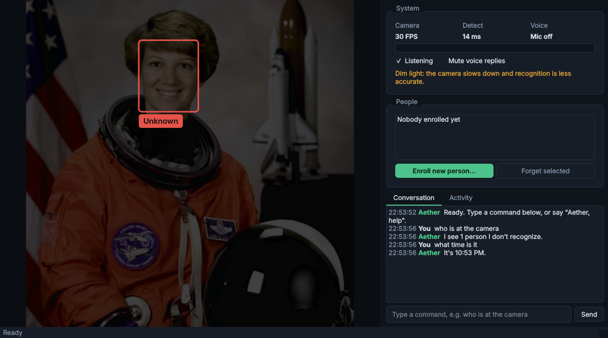
*The window sizes itself to the screen (shown at 1366x768 minus the taskbar), with the dim-light hint.*

## Run everything

```bash
pip install -e ".[vision,audio]" pyttsx3 pytest pytest-asyncio
python main.py --gui           # desktop window (recommended)
python main.py                 # classic OpenCV window
python main.py --no-voice      # camera only        (also: --no-camera, --no-window, --no-tts)
```

Say the wake word first, so ordinary conversation is ignored: **"Aether, ..."** (see *The wake word* below for follow-ups and push-to-talk)

| Say | What happens |
|-----|--------------|
| who is at the camera / who am I | describes who is in view |
| enroll me as `<name>` | captures 10 varied views of the one face in view, then remembers it |
| forget me | deletes the recognized person's stored face data |
| who do you know / status / recent activity | lists enrolled people / system status / last audit events |
| what time is it / what's the date | |
| help / goodbye | lists commands / shuts down |

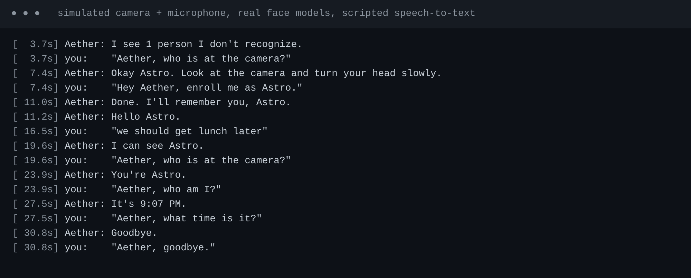
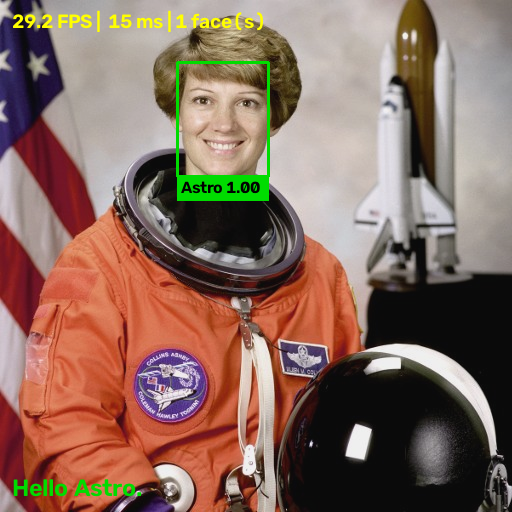
*Simulated camera and microphone with the real face models and a scripted stand-in for Whisper.*

**Safety rules** (this system handles biometric data): audio captured while the assistant is speaking
is ignored, so it never obeys itself; enrolling needs an already-recognized person in view (unless
nobody is enrolled yet); samples can only be added to a name by that person; "forget me" only deletes
the recognized person's own data. Events are logged to a local SQLite file (`storage/aether.db`, git-ignored).

Add your own commands:

```python
async def lock(cmd):
    my_door.lock()
    return "Front door locked."

orchestrator.register_handler("lock_door", [r"\block\b.*\bdoor\b"], lock)
```

## Build order (done)

event bus, settings, spatial engine, camera capture, face detector, recognition, audio, orchestrator.
PySide6 desktop UI.
